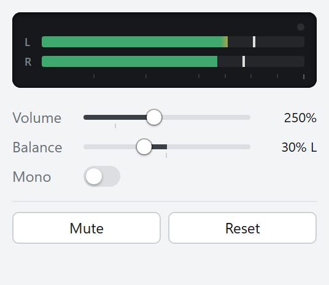
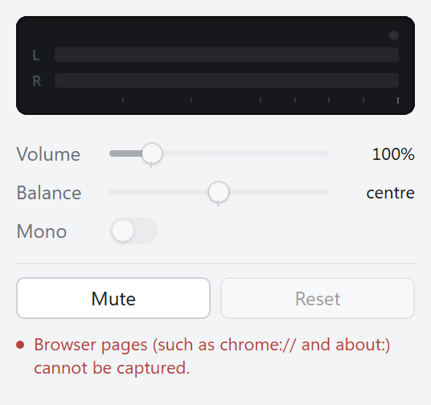
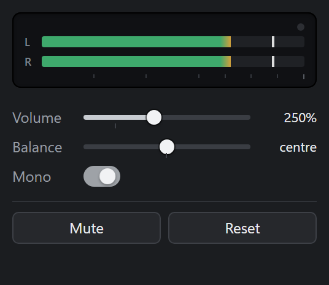

# Sound Chef

A small Chrome extension that changes the sound of one tab at a time. You can boost the volume up to 600%, fold the audio down to mono, and move the balance left or right, with a live level meter in the toolbar popup.

## Screenshots

| Boosted, balance moved left | Page that cannot be captured | Dark theme |
| --- | --- | --- |
|  |  |  |

## Features

- **Volume from 0% to 600%** for each tab. A notch on the slider marks 100%.
- **Mono downmix**: left and right are mixed to (L + R) / 2 and played on both sides.
- **Balance**: in stereo, the far channel is turned down and the near channel stays as it is. In mono, balance pans the signal towards one side.
- **Mute**: uses Chrome's own tab mute, so it works on every page, including ones Sound Chef cannot capture.
- **Level meter**: left and right bars with peak hold and a red light that comes on when the output reaches the limiter ceiling.
- **Limiter**: boosted audio is soft-limited, starting at about -3 dBFS, so it does not hard-clip. A second limiter on the combined output protects you when several boosted tabs play at the same time.
- **Toolbar badge** for each tab: `off` when the tab is muted; otherwise the boost as a percentage (for example `250`), then `M` for mono, then `L` or `R` for balance. Only the first of these that applies is shown.
- **Capture only when needed**: nothing is captured until you move a control away from its default. When a tab goes back to 100%, stereo and centre, capture stops after 1.5 seconds. **Reset** stops it straight away.

## Requirements

- Google Chrome 116 or newer on desktop.
- Other Chromium-based browsers (Edge, Brave and others) may work because they support the same extension APIs, but only Chrome has been tested.

## Install

Sound Chef is not on the Chrome Web Store. You install it as an unpacked extension:

1. Download `sound-chef-<version>.zip` from the [latest release](../../releases/latest).
2. Unzip it into a folder you will keep. Chrome loads the extension from this folder every time it starts, so do not delete it.
3. Open `chrome://extensions` and turn on **Developer mode** (top right).
4. Click **Load unpacked** and select the unzipped folder (the one that contains `manifest.json`).
5. Optional: pin Sound Chef from the puzzle-piece menu so its badge stays visible.

To update, unzip the new release over the same folder (or into a new folder) and click the reload button on the Sound Chef card in `chrome://extensions`.

You can also load a clone of this repository directly. The extension needs no build step.

## Usage

1. Go to a tab that is playing audio and click the Sound Chef icon.
2. Drag **Volume**, **Balance** or switch on **Mono**. The first change starts capturing the tab. Chrome then shows its capture indicator on the tab, and the meter starts moving.
3. **Mute** toggles Chrome's tab mute.
4. **Reset** returns the tab to 100%, stereo and centre, and stops capturing right away.

The settings belong to that tab only. Every tab starts at the defaults.

## Limitations and known issues

- **Some pages cannot be captured**: browser pages (`chrome://`, `about:`, `view-source:` and similar), other extensions' pages, the Chrome Web Store and local `file://` pages. On these pages the popup says why and only **Mute** is available. Chrome's built-in PDF viewer and reader mode may also refuse capture. In that case the popup shows the error that Chrome returned.
- **Settings are per tab and last only for the browser session.** They are lost when you close the tab or restart the browser. They survive navigation within the tab.
- **One capture per tab.** Other tools that capture tab audio, such as some screen recorders or meeting apps that share a tab, may not work on the same tab while Sound Chef is capturing it, and the other way round.
- **Capture indicator**: while Sound Chef processes a tab, Chrome shows its capture indicator on that tab. This is expected.
- **A gesture is needed to start**: Chrome allows tab capture only after you click the extension on that tab. If the page navigates while the popup is open and a control then fails to start, close the popup and open it again.
- **Loud boosts are limited**: at high boost, loud material is compressed by the limiter rather than getting louder. It does not distort by hard-clipping, but heavy limiting changes how the sound feels.

**Hearing and speaker safety**: 600% is a large boost, about +15.6 dB. Start low, especially with headphones, and turn the volume down before you switch between tabs or media.

## Troubleshooting

- **"Browser pages ... cannot be captured" or a similar message**: this page is on the list above. Use **Mute**, or play the audio somewhere else.
- **"Audio capture stopped. Change a control to start it again."**: the capture stream ended. This can happen when the page was replaced (for example by a prerendered page), the tab was discarded, or sharing was stopped. Move any control to start capture again.
- **"Extension has not been invoked for the current page"**: Chrome no longer considers the popup to be opened on this page (usually after the page navigated). Close the popup and open it again.
- **The meter does not move**: the tab is at its defaults (nothing is captured), or the page is silent.
- **The popup says "Unknown state (try reopening the popup)."**: the service worker did not answer, for example while the extension was being reloaded. Close the popup and open it again.

## Privacy and security

- All audio processing happens on your computer, inside the extension, with the browser's Web Audio API.
- Sound Chef makes **no network requests**. It has no analytics, telemetry or remote code, and it does not record or save audio.
- The settings for each tab (volume, mono, balance), the last capture error for each tab and the list of tabs being captured are kept in `chrome.storage.session`. This storage is in memory only and is cleared when the browser exits.

### Permissions

| Permission | Why it is needed |
| --- | --- |
| `tabCapture` | To capture the audio of the tab you are adjusting. Capture starts only after you change a control in the popup. |
| `activeTab` | Opening the popup gives temporary access to the current tab. This allows the capture and lets the popup check whether the tab's address is a page that cannot be captured. Sound Chef does not ask for access to your browsing history or to all sites. |
| `offscreen` | Web Audio processing runs in a hidden offscreen document, because a Manifest V3 service worker cannot play audio. |
| `storage` | To keep the settings for each tab in session storage, which is cleared when the browser exits. |

## Development

The extension is plain JavaScript (ES modules) with no runtime dependencies and no bundler.

```
background/   service worker: messaging, per-tab state, capture lifecycle
common/       protocol shared by every context: message types, state rules, URL checks
offscreen/    offscreen document with the Web Audio engine
popup/        toolbar popup
icons/        extension icons
test/         unit tests (node:test) with a fake chrome API
scripts/      packaging script
dev/          popup preview with a mocked chrome API (development only)
```

Requirements: Node.js 22 or newer. There is nothing to install with npm.

```sh
npm test               # unit tests
npm run build          # writes dist/sound-chef-<version>.zip
npm run preview        # serves the repo on http://127.0.0.1:5178
```

- **Load for development**: open `chrome://extensions`, turn on Developer mode, click **Load unpacked** and pick the repository folder.
- **Popup preview**: `npm run preview`, then open `http://127.0.0.1:5178/dev/popup-preview.html`. It renders the real popup against a mock of the `chrome.*` calls. Query parameters change what it shows, for example `?gain=2.5&balance=-0.3`, `?mono=1`, `?muted=1`, `?restricted=1` or `?silent=1`. See `dev/chrome-mock.js`.
- **Packaging**: `scripts/build.mjs` zips only `manifest.json`, `LICENSE`, `background/`, `common/`, `offscreen/`, `popup/` and `icons/`. Tests, dev tools and docs are not included. It fails if the versions in `manifest.json` and `package.json` differ.
- **Releases**: update `version` in both `manifest.json` and `package.json`, commit, then push a tag such as `v0.2.0`. The release workflow checks that the tag matches the manifest version, runs the tests, builds the zip and attaches it to a GitHub Release. It needs no secrets other than the built-in `GITHUB_TOKEN`.

## Disclaimer

Sound Chef is an independent project. It is not affiliated with, endorsed by or sponsored by Google or the Chrome project. "Chrome" and "Chrome Web Store" are used here only to describe compatibility. Use it at your own risk, and keep the hearing and speaker safety note above in mind.

## License

[MIT](LICENSE), copyright (c) 2026 iefedev.

The icons in `icons/` are part of this project and are covered by the same license. Sound Chef has no third-party code or runtime dependencies.
